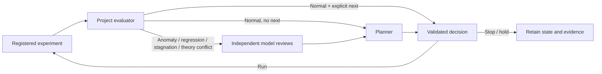

<h1 align="center">Crucible</h1>

<p align="center"><strong>Run experiments. Review the evidence. Keep the loop recoverable.</strong></p>

<p align="center">
  <a href="https://github.com/reo91004/Crucible/actions/workflows/tests.yml"></a>
  <a href="https://www.python.org/downloads/"></a>
</p>

<p align="center">
  <a href="#two-minute-quickstart">Quickstart</a> ·
  <a href="#use-with-opencode">OpenCode</a> ·
  <a href="SPEC.md">Protocol</a> ·
  <a href="VALIDATION.md">Validation</a> ·
  <a href="docs/README.ko.md">한국어</a>
</p>

Crucible is a local CLI for bounded research loops. It runs experiments you register, evaluates their artifacts, and calls models when a result needs investigation or a next-step decision. You can also request a debate about existing evidence. Every attempt, decision, and model call stays with the research project.

**OpenCode first; Claude Code supported.** Use the CLI directly or control it from your host agent. The engine runs independently of the chat session and uses Python 3.11+ with no Python runtime dependencies.

## Two-minute quickstart

Requires Python 3.11+ and Git. No account, API key, model CLI, or package installation is needed for this example.

```bash
git clone https://github.com/reo91004/Crucible.git
cd Crucible

crucible_demo="$(mktemp -d)"
./bin/crucible init --project "$crucible_demo"
./bin/crucible validate --project "$crucible_demo"
./bin/crucible run --project "$crucible_demo"
./bin/crucible status --project "$crucible_demo"
./bin/crucible report --project "$crucible_demo"
```

The loop finishes with `state: stopped`, `run_count: 4`, and `call_count: 0`. It evaluates a synthetic quadratic with a fixed seed and reaches its predeclared target. This demonstrates execution and record keeping; it is not evidence of research performance.

`init` creates example programs and `.crucible/config.json` in the fresh directory. It refuses to replace existing Crucible state or example files.

The source launcher works from the checkout. If you prefer an installed command, install locally in a virtual environment:

```bash
python3 -m venv .venv
.venv/bin/python -m pip install .
.venv/bin/crucible --help
```

These are source-checkout installation instructions; no PyPI release is required.

## Use with OpenCode

Link an initialized project from the Crucible checkout:

```bash
./bin/crucible link-opencode --project "$crucible_demo"
```

Open or reload that research directory in OpenCode. Its native `crucible` tool is scoped to the session's project. The link is written to `.opencode/plugins/crucible/`; it leaves global settings alone and refuses to overwrite an existing link.

Use these tool inputs through your OpenCode agent:

```json
{"action":"start"}
```

```json
{"action":"status"}
```

```json
{"action":"deliver","delivery":"queue"}
```

`start`/`run`, `resume`, and `retry` launch a background worker. Other actions are `debate`, `pause`, `stop`, `cancel`, `reconcile`, `events`, and `report`.

**Delivery is explicit.** `deliver` forwards saved events to the active session and acknowledges each successful delivery. Nothing is automatically pushed, and no model polling loop is started. A crash between delivery and acknowledgement can redeliver the same event ID; delivery does not mean the agent has accepted its scientific conclusion.

The linked demo has already finished. To run model-assisted work, configure a new project as described below. Install and authenticate the model CLI before using it; `doctor` checks executables and versions, without testing authentication or making paid calls.

## How the loop works



| Part | Responsibility |
| --- | --- |
| Experiment | A trusted local program with registered command arguments, typed parameter bounds, inputs, and required artifacts. |
| Evaluator | Your program reads artifacts and history, then reports metrics and an event. A normal result with an explicit next decision needs no model call. |
| Reviews | Investigate flagged results using at least two distinct configured model IDs. First responses receive the same evidence independently; optional rebuttals have a fixed round limit. |
| Planner | Proposes `run`, `stop`, or `hold` from completed evidence and reviews. Every proposed run must use a registered experiment and valid parameters. |

Failed required reviews block the next stage. Evaluator `error` and `insufficient` events also block progress unless they include a concrete, validated recovery decision. Crucible validates this contract; the scientific quality of the evaluator, metrics, hypotheses, and experiment design remains yours.

## Automatic reviews and on-demand debates

Set up the experiment, evaluator policy, models, and budgets once, then start the loop. When an experiment completes and the evaluator flags a result, Crucible requests reviews automatically; you do not need to instruct it at each event. It does not discover or watch experiments started outside Crucible.

For a question about existing evidence, request a separate debate:

```bash
./bin/crucible debate --project /path/to/research-project \
  --question "Do the latest results support the current hypothesis?" \
  --background
```

With no explicit evidence, the debate snapshots the latest completed run when available. Otherwise it is labeled a question-only discussion with no empirical evidence. To submit other project files, repeat `--evidence relative/path`.

Manual debates require at least two distinct configured models and default to zero rebuttal rounds. Set case bounds with `--rounds N` and `--max-calls N`; their call budget is separate from the experiment loop. Read the conclusion and evidence limits in `.crucible/debates/CASE_ID/REPORT.md` or `report.json`.

Debates do not launch experiments or change the main worker's next decision. Use `debate --resume CASE_ID` to recover an interrupted case with its captured evidence and completed calls. Add `--retry` only to explicitly retry a known failure; uncertain provider outcomes remain unresolved until recovery can establish what happened.

In a linked OpenCode project, use `/crucible-debate QUESTION` or the native tool:

```json
{"action":"debate","question":"What would distinguish the competing explanations?","evidence":["results/metrics.json"]}
```

## Bring your own research

For explicit `--evidence` files, provide UTF-8 text up to 64 KiB per file. When using the latest completed run implicitly, larger or binary artifacts are represented by their full hash, size, and an omission notice alongside the recorded evaluator summary. Reviewers cannot inspect omitted content.

The initialized example is a teaching fixture. A real project needs its own `.crucible/config.json`, experiment programs, and evaluator. Your agent can prepare these through the shared skill from your goal, success criteria, commands, and budgets; you do not have to hand-author JSON. The project must define:

- A goal, initial decision, and registered experiment commands with typed parameter bounds.
- Declared input files, required output artifacts, and an evaluator implementing the [JSON protocol](SPEC.md).
- Run and call budgets, model call timeouts, and experiment deadlines where needed.
- Explicit model IDs from your available catalog, plus a planner model.

Commands use argument arrays rather than shell strings. Models can select registered work; they cannot add arbitrary shell commands or write experiment code through the controller.

The experiment loop's default limits are **8 attempts**, **12 model calls**, **120 seconds per model call**, and **1 rebuttal round**. Failures count toward budgets. These limits do not guarantee a token or money cap; experiments have a deadline only when you configure one.

For a synthetic scenario that triggers reviews, create a fresh project with `init --review`, supplying `--opencode-model` and `--claude-model` from your accounts' catalogs. You can also configure two different OpenCode model IDs in `models` to use OpenCode alone. Effort variants of one model do not count as distinct models. There is no universal model ID to copy from this README.

Validate before starting:

```bash
./bin/crucible validate --project /path/to/research-project
./bin/crucible doctor --project /path/to/research-project
./bin/crucible run --project /path/to/research-project --background
```

## Claude Code and ai-prompts

Claude Code can use the same CLI and project state. For host-agent instructions, the companion [ai-prompts repository](https://github.com/reo91004/ai-prompts) provides a shared [Crucible skill](https://github.com/reo91004/ai-prompts/tree/main/skills/crucible) for OpenCode, Claude Code, and Codex.

The default ai-prompts installer reuses a checkout under HOME or downloads it to `~/Crucible` and records its path. No path setting is required; `CRUCIBLE_ROOT` or a CLI on `PATH` can override discovery. Existing checkouts are preserved. In Claude Code, invoke `/crucible debate QUESTION` or ask the installed skill to investigate the evidence. The kit supplies instructions and a launcher; the separate Crucible engine owns execution. Research state stays in the research project's `.crucible/`, never in the prompt kit.

Direct CLI use also works without the kit:

```bash
/path/to/Crucible/bin/crucible status --project /path/to/research-project
```

## Commands

All commands accept `--project PATH`; it defaults to the current directory. CLI output is JSON except `report`.

| Command | Use |
| --- | --- |
| `init` | Create a fresh synthetic project; `--review` enables the review scenario. |
| `validate` / `doctor` | Check the project contract / installed CLI versions. |
| `link-opencode` | Add the project-local native OpenCode tool. |
| `run` | Execute the loop; `--once` limits one worker pass, `--background` detaches it. |
| `debate` | Start with `--question TEXT`, optional `--evidence`, `--rounds`, `--max-calls`, and `--background`; recover with `--resume CASE_ID`, optionally `--retry`. |
| `status` | Inspect state, ownership, counts, and the next decision. |
| `pause` / `stop` | Prevent subsequent work while leaving active jobs alive. |
| `resume` | Continue existing work; supports `--once` and `--background`. |
| `cancel` | Request cancellation of the active experiment/evaluator process group. |
| `reconcile` | Check saved receipts and process identity after interruption. |
| `retry` | Explicitly retry a failed stage; supports `--once` and `--background`. |
| `decide --file decision.json` | Supply a validated operator decision when no attempt is active. |
| `events` / `ack EVENT_ID` | Read pending events / acknowledge one; `events --all` includes acknowledged events. |
| `report` | Generate the human-readable report from saved state. |

## Persistence and recovery

Each project has one worker owner. SQLite journals attempts, calls, decisions, and events. Attempt directories retain configuration and input snapshots, hashes, command arguments, artifacts, evaluator results, and runner receipts. Model calls retain their prompts, raw output, errors, and available provider metadata. `.crucible/REPORT.md` is a human-readable view; it does not replace your research records.

The worker can continue after the host session closes. After an interruption, inspect `status` and use `reconcile`; uncertain launches or provider outcomes remain `reconciliation_required` until resolved. They are never silently rerun. `retry` retains the failure history, and retrying an experiment creates another budgeted attempt. Exactly-once external effects are not guaranteed.

Keep one writer for research code and do not change active inputs or configuration. `pause` and `stop` leave running jobs alive. `cancel` requests active job termination, but during a synchronous model call it takes effect at the next boundary; that call keeps its own timeout. A UI/tool wait timeout does not cancel an experiment.

## Scope and validation

- Crucible runs trusted local programs without an OS sandbox. Review packets restrict model tools and expose bounded artifact text; large or binary artifacts may be represented only by hashes, sizes, and omission notices.
- Provenance covers declared inputs and available Git/runtime information. Declare supporting code and data manifests; this is not a complete environment snapshot.
- Raw records can contain sensitive prompts, data, and provider output. Choose what to share.
- Linux execution and recovery are tested. macOS process identity has mocked tests only; live macOS execution is unverified. Windows is outside the current process/locking implementation.
- Python and Node checks cover execution, recovery, and the OpenCode bridge. A live OpenCode synthetic loop completed with **3 experiments and 3 model calls**. Live Claude success remains unverified because the available account hit its weekly quota. These checks do not establish scientific superiority or provider-independent reliability.

See [VALIDATION.md](VALIDATION.md) for the tested scope and [SPEC.md](SPEC.md) for configuration, evaluator, review, and recovery contracts.

```bash
python3 -m unittest discover -s tests -v
node --test tests/test_opencode_bridge.mjs
```
