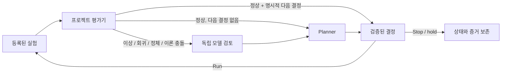

<h1 align="center">Crucible</h1>

<p align="center"><strong>실험하고, 증거를 검토하고, 중단된 연구 루프를 이어갑니다.</strong></p>

<p align="center">
  <a href="https://github.com/reo91004/Crucible/actions/workflows/tests.yml"></a>
  <a href="https://www.python.org/downloads/"></a>
</p>

<p align="center"><a href="../README.md">English</a> · <a href="../SPEC.md">프로토콜</a> · <a href="../VALIDATION.md">검증 범위</a></p>

Crucible은 실행 범위와 예산을 정해 두고 사용하는 로컬 연구 루프 CLI입니다. 등록된 실험을 실행하고 산출물을 평가하며, 결과 조사나 다음 단계 결정이 필요할 때 모델을 호출합니다. 기존 증거에 대한 토론을 직접 요청할 수도 있습니다. 모든 시도·결정·모델 호출은 연구 프로젝트에 남습니다.

**OpenCode 우선이며 Claude Code도 지원합니다.** CLI를 직접 쓰거나 호스트 에이전트에서 제어할 수 있습니다. 엔진은 대화 세션과 별도로 실행되며 Python 3.11 이상 표준 라이브러리를 사용합니다.

## 2분 빠른 시작

Python 3.11 이상과 Git이 필요합니다. 이 예제는 계정·API 키·모델 CLI·패키지 설치 없이 실행됩니다.

```bash
git clone https://github.com/reo91004/Crucible.git
cd Crucible

crucible_demo="$(mktemp -d)"
./bin/crucible init --project "$crucible_demo"
./bin/crucible validate --project "$crucible_demo"
./bin/crucible run --project "$crucible_demo"
./bin/crucible status --project "$crucible_demo"
./bin/crucible report --project "$crucible_demo"
```

최종 상태는 `state: stopped`, `run_count: 4`, `call_count: 0`입니다. 고정 seed의 합성 이차함수를 평가해 사전 지정 목표에 도달합니다. 실행과 기록 방식을 보여 주는 예제이며 실제 연구 성능의 증거는 아닙니다.

`init`는 새 디렉터리에 예제 프로그램과 `.crucible/config.json`을 만듭니다. 기존 Crucible 상태나 예제 파일을 덮어쓰지 않습니다.

소스 checkout의 실행기를 바로 쓸 수 있습니다. 설치된 명령을 원하면 가상환경에 로컬 설치하세요.

```bash
python3 -m venv .venv
.venv/bin/python -m pip install .
.venv/bin/crucible --help
```

위 명령은 checkout의 로컬 설치입니다. PyPI 배포를 전제로 하지 않습니다.

## OpenCode에서 사용하기

Crucible checkout에서 초기화한 프로젝트를 연결합니다.

```bash
./bin/crucible link-opencode --project "$crucible_demo"
```

해당 연구 디렉터리의 OpenCode 세션을 열거나 다시 불러오면 네이티브 `crucible` 도구가 생깁니다. 작업 경로는 세션의 프로젝트로 고정됩니다. 연결 파일은 `.opencode/plugins/crucible/`에 생성되며 전역 설정을 바꾸거나 기존 연결을 덮어쓰지 않습니다.

OpenCode 에이전트에서 다음 도구 입력을 사용합니다.

```json
{"action":"start"}
```

```json
{"action":"status"}
```

```json
{"action":"deliver","delivery":"queue"}
```

`start`/`run`, `resume`, `retry`는 background worker를 시작합니다. 다른 action은 `debate`, `pause`, `stop`, `cancel`, `reconcile`, `events`, `report`입니다.

**사건 전달은 `deliver`로 명시적으로 요청합니다.** 저장된 사건을 활성 세션에 전달하고 성공한 사건만 승인합니다. 자동 push나 모델 상태 polling은 없습니다. 전달 후 승인 전에 중단되면 같은 사건 ID가 재전달될 수 있습니다. 전달 성공은 에이전트가 과학적 결론을 수용했다는 뜻이 아닙니다.

빠른 시작의 예제는 이미 완료된 상태입니다. 모델을 사용하는 새 작업은 아래 설명대로 설정하세요. 사용할 모델 CLI의 설치와 인증은 별도로 필요합니다. `doctor`는 실행 파일과 버전만 확인하며 인증이나 유료 호출을 시험하지 않습니다.

## 연구 루프의 역할



| 구성 요소 | 하는 일 |
| --- | --- |
| 실험 | 명령 인자·자료형과 범위가 정해진 매개변수·입력·필수 산출물을 등록한 신뢰할 수 있는 로컬 프로그램입니다. |
| 평가기 | 사용자가 작성한 프로그램이 산출물과 이력을 읽고 지표와 사건을 반환합니다. 정상 결과에 명시적 다음 결정이 있으면 모델을 부르지 않습니다. |
| 검토 | 최소 두 개의 서로 다른 설정 모델 ID로 문제가 생긴 결과를 조사합니다. 첫 응답에는 같은 증거를 독립적으로 주며 반박 횟수도 제한합니다. |
| Planner | 완료된 증거와 검토를 바탕으로 `run`, `stop`, `hold`를 제안합니다. 실행 제안은 등록된 실험과 유효한 매개변수여야 합니다. |

필수 검토가 실패하면 다음 단계로 진행하지 않습니다. 평가기의 `error`·`insufficient`도 구체적이고 검증 가능한 복구 결정을 포함하지 않으면 진행을 막습니다. Crucible은 이 실행 계약을 검사합니다. 평가기·지표·가설·실험 설계의 과학적 타당성은 프로젝트에서 정해야 합니다.

## 자동 검토와 수동 토론

명시적 `--evidence` 파일은 파일당 64 KiB 이하 UTF-8 텍스트를 사용합니다. 최신 완료 실행을 기본 증거로 가져올 때 큰 파일·바이너리는 전체 hash·크기·생략 사유와 기존 평가 요약으로 표현합니다. 모델이 생략된 내용을 읽었다고 간주하지 않습니다.

실험·평가 정책·모델·예산을 한 번 설정하고 루프를 시작하면, 실험이 끝난 뒤 평가기가 사건을 보고할 때 자동으로 검토를 요청합니다. 사건마다 사용자가 다시 지시할 필요는 없습니다. Crucible 밖에서 시작한 실험을 자동으로 발견하거나 감시하지는 않습니다.

기존 증거에 대한 질문은 별도 토론으로 요청할 수 있습니다.

```bash
./bin/crucible debate --project /path/to/research-project \
  --question "Do the latest results support the current hypothesis?" \
  --background
```

증거를 지정하지 않으면 가장 최근에 완료된 실행이 있을 때 snapshot으로 남깁니다. 없으면 실증 증거가 없는 질문만의 토론이라고 표시합니다. 다른 프로젝트 파일은 `--evidence relative/path`를 반복해 지정합니다.

수동 토론에는 서로 다른 설정 모델이 최소 두 개 필요하며 기본 반박 차수는 0입니다. `--rounds N`과 `--max-calls N`으로 사건별 범위를 정하고 실험 루프와 별도 호출 예산을 사용합니다. 결론과 증거의 한계는 `.crucible/debates/CASE_ID/REPORT.md` 또는 `report.json`에서 확인합니다.

토론은 실험을 실행하거나 주 worker의 다음 결정을 바꾸지 않습니다. 중단된 사건은 `debate --resume CASE_ID`로 캡처한 증거와 완료된 호출을 재사용해 복구합니다. 확인된 실패를 명시적으로 재시도할 때만 `--retry`를 추가합니다. provider 결과가 불확실하면 복구로 사실을 확인할 때까지 미해결 상태로 남습니다.

연결된 OpenCode 프로젝트에서는 `/crucible-debate QUESTION` 또는 네이티브 도구를 사용합니다.

```json
{"action":"debate","question":"What would distinguish the competing explanations?","evidence":["results/metrics.json"]}
```

## 실제 연구 연결하기

초기 예제는 사용법을 위한 합성 실험입니다. 실제 프로젝트에는 자체 `.crucible/config.json`, 실험 프로그램, 평가기가 필요합니다. 공통 skill을 통해 에이전트가 사용자의 목표·성공 기준·실행 명령·예산을 받아 준비할 수 있으므로 JSON을 직접 작성할 필요는 없습니다. 프로젝트에는 다음 항목이 필요합니다.

- 목표·초기 결정·등록할 실험 명령과 매개변수의 자료형·범위를 정합니다.
- 입력 파일·필수 산출물을 선언하고 [JSON 프로토콜](../SPEC.md)에 맞는 평가기를 작성합니다.
- 실행·호출 예산, 모델 호출 timeout, 필요한 실험 deadline을 설정합니다.
- 사용할 수 있는 catalog의 모델 ID를 명시하고 planner 모델을 정합니다.

명령은 shell 문자열 대신 인자 배열을 사용합니다. 모델은 등록된 작업을 선택할 수 있으며 제어기를 통해 임의의 shell 명령을 추가하거나 실험 코드를 작성할 수는 없습니다.

실험 루프의 기본 제한은 **시도 8회**, **모델 호출 12회**, **호출당 120초**, **반박 1차수**입니다. 실패도 예산에 포함됩니다. 토큰·금액 상한을 보장하지 않으며 실험 deadline은 직접 지정한 경우에만 적용됩니다.

검토를 유발하는 합성 예제는 새 프로젝트에서 `init --review`로 만듭니다. `--opencode-model`과 `--claude-model`에는 각 계정의 catalog에서 확인한 ID를 넣으세요. `models`에 서로 다른 OpenCode 모델 ID 두 개를 설정해 OpenCode만 사용할 수도 있습니다. 같은 모델의 effort 차이는 서로 다른 모델로 세지 않습니다. 모든 계정에 통용되는 모델 ID는 가정하지 않습니다.

실행 전 설정과 CLI를 확인합니다.

```bash
./bin/crucible validate --project /path/to/research-project
./bin/crucible doctor --project /path/to/research-project
./bin/crucible run --project /path/to/research-project --background
```

## Claude Code와 ai-prompts

Claude Code에서도 같은 CLI와 프로젝트 상태를 사용합니다. 호스트 에이전트용 지침은 [ai-prompts](https://github.com/reo91004/ai-prompts)의 공통 [Crucible skill](https://github.com/reo91004/ai-prompts/tree/main/skills/crucible)을 통해 OpenCode·Claude Code·Codex에서 사용할 수 있습니다.

공통 skill을 쓸 때는 `CRUCIBLE_ROOT`를 Crucible checkout 경로로 지정하거나 CLI를 `PATH`에 설치합니다. Claude Code에서는 `/crucible debate QUESTION`으로 호출하거나 설치한 skill에 증거 조사를 자연어로 요청합니다. prompt kit은 지침과 실행기를 제공하고, 별도 Crucible 엔진이 실행을 맡습니다. 연구 상태는 kit에 복사하지 않고 연구 프로젝트의 `.crucible/`에 둡니다.

kit 없이 CLI만 직접 사용해도 됩니다.

```bash
/path/to/Crucible/bin/crucible status --project /path/to/research-project
```

## 명령어

모든 명령에 `--project PATH`를 쓸 수 있으며 기본값은 현재 디렉터리입니다. `report`를 제외한 CLI 출력은 JSON입니다.

| 명령 | 용도 |
| --- | --- |
| `init` | 새 합성 예제 생성. `--review`는 검토 시나리오를 활성화합니다. |
| `validate` / `doctor` | 프로젝트 계약 / 설치된 CLI 버전 확인. |
| `link-opencode` | 프로젝트 전용 네이티브 OpenCode 도구 연결. |
| `run` | 루프 실행. `--once`는 worker 1회 처리, `--background`는 분리 실행. |
| `debate` | `--question TEXT`로 시작. `--evidence`·`--rounds`·`--max-calls`·`--background` 선택, `--resume CASE_ID`로 복구하며 필요하면 `--retry` 추가. |
| `status` | 상태·소유권·횟수·다음 결정 확인. |
| `pause` / `stop` | 실행 중 작업을 유지하고 후속 작업을 막음. |
| `resume` | 기존 작업 계속. `--once`·`--background` 지원. |
| `cancel` | 실행 중 실험·평가기 프로세스 그룹에 취소 요청. |
| `reconcile` | 중단 후 저장된 영수증과 프로세스 식별 정보 확인. |
| `retry` | 실패 단계의 재시도를 명시적으로 승인. `--once`·`--background` 지원. |
| `decide --file decision.json` | 활성 시도가 없을 때 검증된 운영자 결정 입력. |
| `events` / `ack EVENT_ID` | 미승인 사건 조회 / 사건 승인. `events --all`은 승인된 사건도 포함. |
| `report` | 저장된 상태로 사람이 읽는 보고서 생성. |

## 기록과 복구

프로젝트당 worker 하나가 소유권을 가집니다. SQLite에 시도·호출·결정·사건을 기록하고 시도별 디렉터리에 설정과 입력 snapshot, hash, 명령 인자, 산출물, 평가, runner 영수증을 보존합니다. 모델별 prompt·원시 출력·오류·확인 가능한 provider metadata도 남습니다. `.crucible/REPORT.md`는 사람이 읽는 요약이며 기존 연구 기록을 대체하지 않습니다.

호스트 세션이 닫혀도 worker는 계속 실행할 수 있습니다. 중단 뒤에는 `status`를 확인하고 `reconcile`을 사용하세요. 시작 여부나 provider 결과를 확정하지 못하면 `reconciliation_required`에 남으며 자동 재실행하지 않습니다. `retry`는 이전 실패를 보존하고, 실험 재시도는 예산에 포함되는 새 시도를 만듭니다. 외부 효과의 exactly-once 실행은 보장하지 않습니다.

연구 코드를 수정하는 주체는 하나로 유지하고 활성 입력·설정을 바꾸지 마세요. `pause`·`stop`은 실행 중 작업을 종료하지 않습니다. `cancel`은 활성 작업 종료를 요청하지만 동기 모델 호출 중에는 다음 경계에서 반영되며 호출 자체의 timeout은 유지됩니다. UI나 도구의 대기 timeout은 실험 취소가 아닙니다.

## 검증 범위와 한계

- 신뢰할 수 있는 로컬 프로그램을 실행하며 OS sandbox는 제공하지 않습니다. 검토 packet은 모델 도구 사용을 제한하고 산출물 텍스트를 일부 제공합니다. 큰 파일·바이너리는 hash·크기·생략 안내만 포함할 수 있습니다.
- 추적 범위는 선언된 입력과 확인 가능한 Git·runtime 정보입니다. 지원 코드와 데이터 manifest도 선언해야 하며 완전한 환경 snapshot은 아닙니다.
- 원시 기록에는 민감한 prompt·데이터·provider 출력이 포함될 수 있으므로 공유 범위를 직접 정하세요.
- Linux 실행·복구를 검사했습니다. macOS 프로세스 식별은 모의 검사만 수행했으며 실제 Mac 실행은 미검증입니다. Windows는 현재 프로세스·잠금 구현의 지원 범위 밖입니다.
- Python·Node 검사로 실행·복구·OpenCode bridge를 확인합니다. 실제 OpenCode 합성 루프에서 **실험 3회·모델 호출 3회 완료**를 확인했습니다. Claude 실제 성공 호출은 계정의 주간 한도 때문에 미검증입니다. 이 결과는 과학적 우월성이나 provider 전반의 신뢰성을 입증하지 않습니다.

자세한 검증 범위는 [VALIDATION.md](../VALIDATION.md), 설정·평가기·검토·복구 계약은 [SPEC.md](../SPEC.md)를 참고하세요.

```bash
python3 -m unittest discover -s tests -v
node --test tests/test_opencode_bridge.mjs
```
